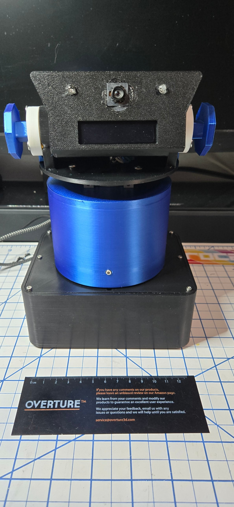
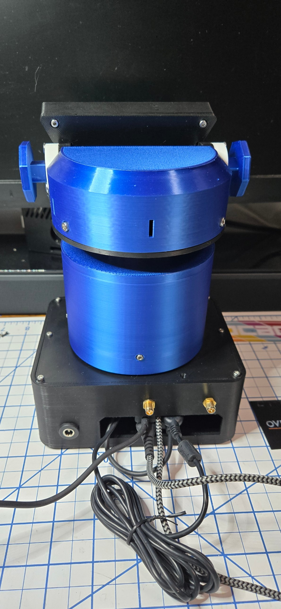

# Piper-Watch

**Piper-Watch** is the body of [piper-assistant](https://github.com/stvenmobile/piper_assistant): a small
desktop robot with a head that turns (pan) and nods (tilt), a camera to see who is there, and an OLED
**mouth** that shows what Piper is doing and how she "feels".

Everything is built around a **Jetson Orin NX** on a Seeed **reComputer J401** carrier, which sits inside
the printed base and runs all the software (speech, vision, the head link). Two **STS3215** bus servos
move the head; the Orin drives them directly over USB through a Waveshare bus servo adapter. A
**XIAO ESP32-S3** in the turret drives the mouth.

> **Status (2026-11-26):** version 1 is **built and working**: the tilting head (v6) with the OLED mouth and the
> webcam, on the pan/tilt turret (photos below). A second head, pan-only with a 5" screen face (v7), is being
> printed. Both are kept as options: see [Head options](#head-options).

| Front | Back |
| --- | --- |
|  |  |

*Version 1, finished. The ring that should hide the gap above the skirt (`surround4`) was never printed, so the
pan hub shows there; head v7's turret top includes that ring.*

> **Build warning - cable routing is extremely tight.** The camera's and the XIAO's USB cables and the
> tilt servo's lead all pass through the pan joint: the turret floor, the hub's **19 mm** bore, and the
> hub's cable window, which opens into a **20.6 mm** gap over the pan servo. A moulded USB-A plug will
> not make that turn. Route the cables **small end first, from below**, with a pull cord (run book step
> 3.9), or pull them through bare and fit solder-on USB-A plugs afterwards. If you change any of those
> dimensions, check that the cables still go through before you print.

---

## Head options

| | Option A: tilting head (v6) | Option B: pan-only screen head (v7) |
| --- | --- | --- |
| Status | **Built and working** (2026-11) | **In progress**: designed, printing (head_v7 0.2.0) |
| Moves | pan and tilt (two STS3215) | pan only; the head is fixed to a new turret top |
| Face | 2.08" OLED mouth + two LED "eyes" | 5" CrowPanel Advanced ESP32-P4 (800 x 480 IPS): drawn eyes and mouth (`firmware/face_p4`) |
| Camera | webcam board behind the brow | the same webcam board, fixed 4 deg up |
| Sources | `parts/base_v4.scad` (turret, cowl, tilt linkage, cheeks, ears) + `parts/head_v6.scad` | `parts/head_v7.scad` (turret top, shell, back panel, camera strap), on the same base, pan servo and hub |
| Run book | [steps 1-5](hardware/cad/docs/build_photos/README.md) | to be written when it is built |

Option A is a complete, proven build and stays in the repository. Option B drops the tilt mechanism to
give the screen face a simple, clean housing: the screen's drawn eyes can glance up and down instead.
Everything below the turret (tub, lid, skirt, pan servo, hub) is shared.

## How it fits together (option A)

```text
             HEAD (tilts)   webcam board (lens + two LED "eyes" behind glass domes), 2.08" OLED mouth
                │  tilt: 27 mm rod from the tilt servo's crank
             TURRET (pans)  tilt servo (STS3215, ID 2), XIAO ESP32-S3 (mouth), cowl, cheeks with 608 bearings
                │  hub through a 1" pillow-block bearing; the cables go down its bore
             SKIRT          pan servo (STS3215, ID 1) hanging under the plate, in a sleeve
                │  slips over the round wall, 4 x M2.5
             LID + WALL     Waveshare Bus Servo Adapter (A) on standoffs; cable slot into the tub
             TUB            reComputer J401 carrier + Orin NX, 12 V split block, DC jack, power button,
                            Wi-Fi antennas; the USB plugs go into the Orin from outside, through the back wall
```

| Part | Role |
| --- | --- |
| Jetson **Orin NX** on a Seeed **reComputer J401** carrier | runs piper-assistant: speech, vision, the head link, the dashboard |
| 2 x Feetech **STS3215** (12 V bus servos) | pan (ID 1) and tilt (ID 2), daisy-chained |
| **Waveshare Bus Servo Adapter (A)** | the servos' bus, on USB to the Orin; 12 V in on its screw terminal |
| ServoCity **1" bore pillow block** | the pan bearing: carries the turret and head |
| **XIAO ESP32-S3** (or XIAO MG24) | drives the mouth; USB serial to the Orin |
| 2.08" **SH1122** OLED, 256 x 64 (GME25664-65) | the mouth |
| Logitech webcam board (210-002028-003), out of its housing | the camera |
| **12 V, at least 5 A** supply | the Orin and the servos ([wiring](hardware/wiring.md)) |
| Printed parts, PETG | see the [run book](hardware/cad/docs/build_photos/README.md) |

The speakerphone (SP-200) also plugs into the Orin, away from the head.

## Building it

- **[Run book](hardware/cad/docs/build_photos/README.md):** what to print, the hardware for each step,
  and the assembly from the tub up, with photos and renders.
- **[Wiring](hardware/wiring.md):** power (12 V split, fuse, power button), the mouth OLED's pins, cable routes.
- **CAD:** parametric OpenSCAD in [hardware/cad/](hardware/cad/); `hardware/cad/export.sh` renders every
  printable part to `hardware/cad/out/`.
- **Servo setup:** [tools/servo_test](tools/servo_test) sets IDs, centres and the tilt limits (bench, over the adapter's USB).

## Software

- **The mouth:** [firmware/mouth](firmware/mouth). Modes (neutral, talk, happytalk, smile, frown, surprise,
  sleep, happysleep, research, blank) and a status symbol, set by one-line serial commands from the Orin.
  `firmware/oled_test` is the OLED's bring-up test.
- **Everything else runs in piper-assistant:** the head link (`src/piper_head/link.py`) drives the mouth, `src/piper_head/servos.py`
  the pan and tilt servos (limits and home in its `config.yaml`, `head.servos`), and `src/piper_vision` the camera.

## Repository layout

```text
firmware/mouth/        the mouth: XIAO + SH1122 OLED (PlatformIO for the ESP32-S3, Arduino CLI for the MG24); sim/ is its browser simulator
firmware/oled_test/    OLED bring-up test
hardware/wiring.md     power, the mouth's pins, cable routes
hardware/cad/          OpenSCAD: parts/ (sources), out/ (exported .3mf, not committed), docs/build_photos/ (the run book)
tools/servo_test/      STS3215 bench tools (IDs, centring, limits, moves)
docs/                  datasheets (the OLED)
```
