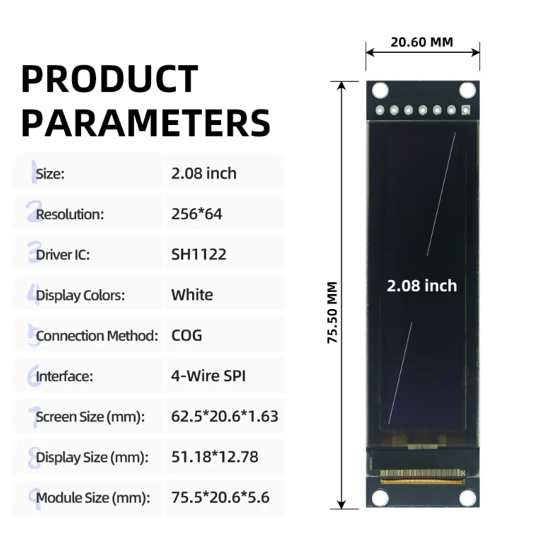
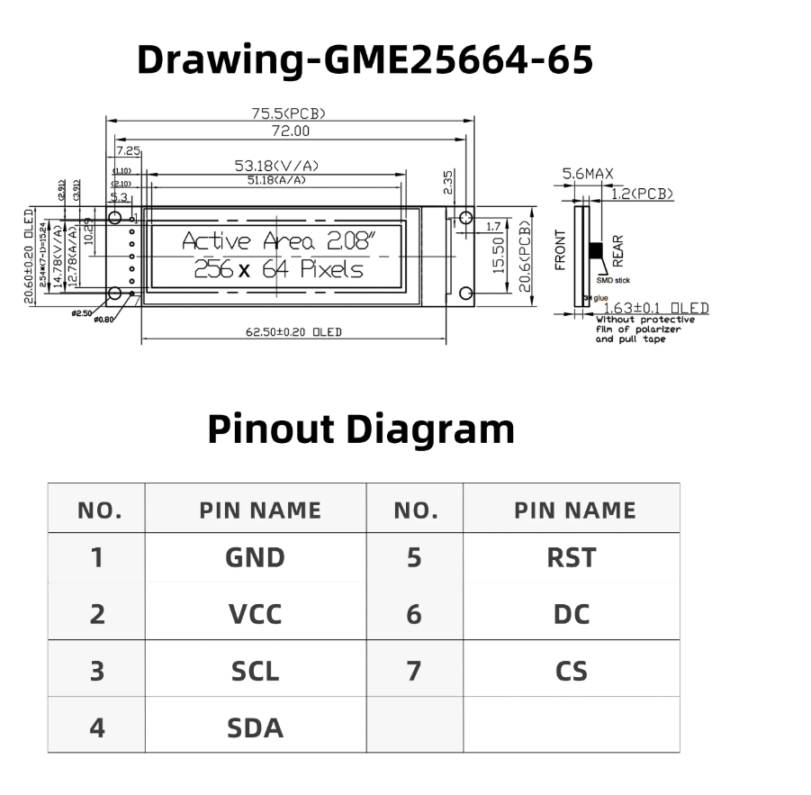

# GME25664-65 2.08" OLED (256 x 64, SPI)

Candidate "eyes" display for the cowl brow (see `hardware/cad/parts/base_v4.scad`). Vendor sheets:
[parameters](oled_gme25664-65_params.png), [mechanical drawing and pinout](oled_gme25664-65_drawing.png).

| Item | Value |
|---|---|
| Controller | SH1122 (vendor sheet), 256 x 64, white, 4-wire SPI, COG |
| Module (PCB) | 75.5 x 20.6 x 5.6 mm max (PCB 1.2) |
| Glass | 62.5 x 20.6 x 1.63 mm |
| Active area | 51.18 x 12.78 mm (view area 53.18 x 14.78) |
| Mounting | 4 x 2.5 mm holes; 72.0 mm centres in X, 15.5 mm in Y |
| Pins (7, 2.54 mm) | 1 GND, 2 VCC, 3 SCL, 4 SDA, 5 RST, 6 DC, 7 CS |

Note: the first page of the sheet lists the module as 75.5 x 20.6 (pin header on the short end), not the ~60 x 19 mm figure
of other 2.08" panels, so the cowl brow has to be sized from this drawing.
