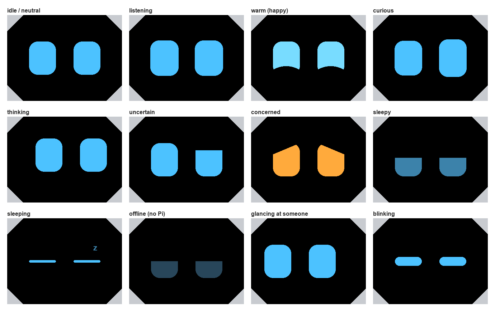

# Piper's face: CYD firmware

Firmware for the **Guition ESP32-2432S024** (2.4" CYD) in Piper's head. It draws the **eyes** on the
screen and drives the **mouth**, an Adafruit NeoPixel Ring 12 round the camera lens. The Pi or Orin talks
to it over the board's USB using the head-link messages: `HEARTBEAT`, `FACE` (state, mood, attention),
`MOUTH` (speech level) and `CONFIG`. See the top of `src/main.cpp` for the details.



## Build and flash

From this folder, with the CYD on USB:

```
pio run -e cyd24 -t upload
pio device monitor
```

With no Pi connected it runs a **demo**: every 4 seconds it switches to a new state and mood, eyes and
mouth together. The first heartbeat from the Pi ends the demo. If the Pi then goes quiet for 3 seconds,
the face shows **offline**: dim, half-shut eyes and a faint amber mouth.

If the picture comes out upside down or the colours look wrong, change `TFT_ROTATION`, `TFT_INVERT` or
`TFT_BGR` in `platformio.ini`.

## Wiring the mouth (NeoPixel Ring 12)

The ring has four pads on the back: **5V DC Power**, **Power Signal Ground**, **Data Input** and
**Data Output**. Data Output stays unconnected.

| Ring pad | CYD | Notes |
|---|---|---|
| **Data Input** | **IO22**, on the **CN1** (or P3) connector | through a **330 Ω resistor**, close to the ring |
| **5V DC Power** | **5V**, on the **P1** (serial) connector | USB power: about 0.1–0.2 A at the brightness used (capped at 24/255) |
| **Power Signal Ground** | **GND**, on CN1 or P1 | |

- **Don't use IO27:** on the 2.4" CYD it drives the screen's backlight. IO21, also on P3, may be the
  touch controller's interrupt. IO35 can only be used as an input.
- **Read the labels on your own board.** Published pin orders for CN1 and P3 differ from one source to
  another, so check the silkscreen next to each connector before plugging anything in.
- **Optional:** a 100–470 µF capacitor across the ring's 5V and GND pads smooths the power when the
  LEDs switch. Adafruit recommends one; for 12 LEDs at low brightness it's a nice-to-have.
- The CYD's connectors are 1.25 mm JST. The board usually ships with matching pigtails.

### If the ring flickers or shows wrong colours

The ESP32's data signal is 3.3 V. The LEDs, powered from 5 V, officially want at least 3.5 V for a
"high". Over a short wire it usually works anyway. If it doesn't, either of these fixes it:

1. **A diode in the 5 V feed** (1N4001 or similar, stripe toward the ring). It runs the ring at about
   4.3 V, so 3.3 V data counts as a clean "high". This is the simplest fix, and the LEDs barely dim.
2. **A 74AHCT125 level shifter** between IO22 and Data Input, powered from 5 V, as the old 24-LED ring
   design used.
