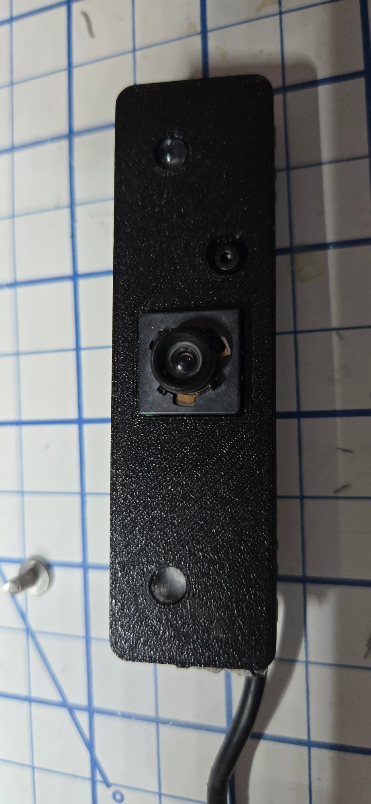

# Robot v4: assembly run book

One step at a time. Each step has the parts and hardware it needs, what to do, and a render of what it should look like.
Photos of the real build go in this folder, named `NN_what_it_shows.jpg`, and get added under the step they belong to.
Renders (`NN_render_*.png`) come from `parts/base_v4.scad` (`part = "head_view"`).

## Done

### Step 1: camera on the camframe ✅

The webcam PCB (Logitech 210-002028-003) is fitted to the camframe: lens in its square pocket, glass eyes in the D3 and D6 seats,
mic cans in their pockets. One side is held by an M2.5 x 12 bolt through the edge slot, the mic side is hot-glued.

*01: webcam PCB, rear: M2.5 screw through the edge slot, thermal pad, chips.*

*02: camera on the camframe from the front. USB cable leaves at the bottom.*

## Next

### Step 2: head plate: insert, OLED, camera ⏭

**You need:** the printed head, the camera on its camframe (step 1), the OLED (2.08", GME25664-65), 1 x M2.5 heat-set insert,
4 x M2 short self-tapping screws, 1 x **M2.5 x 16** screw, 1 x M3 heat-set insert, soldering iron, a zip tie.
**Nothing more to print for this step.**

*03: the finished head from the front: camera frame on the plate, the OLED window below it.*

*04: the head from the rear. The M2.5 boss in the middle, the zip-tie tab at the left, the OLED board across the bottom.*

*05: exploded, from the rear: OLED, head plate, camera board, camframe.*

1. **Inserts.** M2.5 insert into the boss on the rear of the plate, pressed in from the boss's rear end. M3 insert into the crank bracket on the left arm, pressed in from its free face. Check each with a screw.
2. **OLED.** Glass into the pocket from the rear (the front lip keeps it in), board flat on the plate, 4 x M2 into the corner pilot holes. Do not overtighten. Lead the wires down and zip-tie them at the tab on the plate's rear, above the board's left end.
3. **Camera.** Camera on the plate's front face, lens cube into its pocket in the camframe, glass eyes in their seats. Put the **M2.5 x 16** screw through the frame tab and the board's edge slot into the plate's insert, and tighten until the frame sits firm on the cube's bosses.
   The frame's rear face stands 6.7 mm off the plate, so the 12 mm bolt in photo 02 would grip only about 2 mm of the insert.
4. **Check.** The camera does not rock, the OLED glass is flush in its window, the USB cable has a free run out of the frame bottom.

Add your photos here: `06_head_oled_fitted.jpg`, `07_head_camera_fitted.jpg`.

## After that (not detailed yet)

| Step | What | Parts still to print |
|---|---|---|
| 3 | Inserts in the turret (strap 2, cowl 2, covers 6) and hub (4) | none: turret and hub are printed |
| 4 | Hub and turret on the pan stack, 4 x M3 x 8 | none |
| 5 | Tilt servo in its cradle, strap, crank on the horn | **strap** (`base_strap_v4.3mf`) |
| 6 | 608 bearings and the head into the cheeks | see the note below |
| 7 | Tilt rod (M3 rod, 2 rose joints) | none |
| 8 | XIAO, wiring, cheek covers, cowl | **2 covers** (`base_cover_v4.3mf`), and the cowl if it was printed before commit c652f5e |

**Note on step 6:** the head's printed axle stubs run from the arm through the whole cheek, and the cheeks leave a 1 mm gap, so the head cannot be put in once the cheeks are fixed. This needs a design change before step 6 (for example a separate axle pin).
