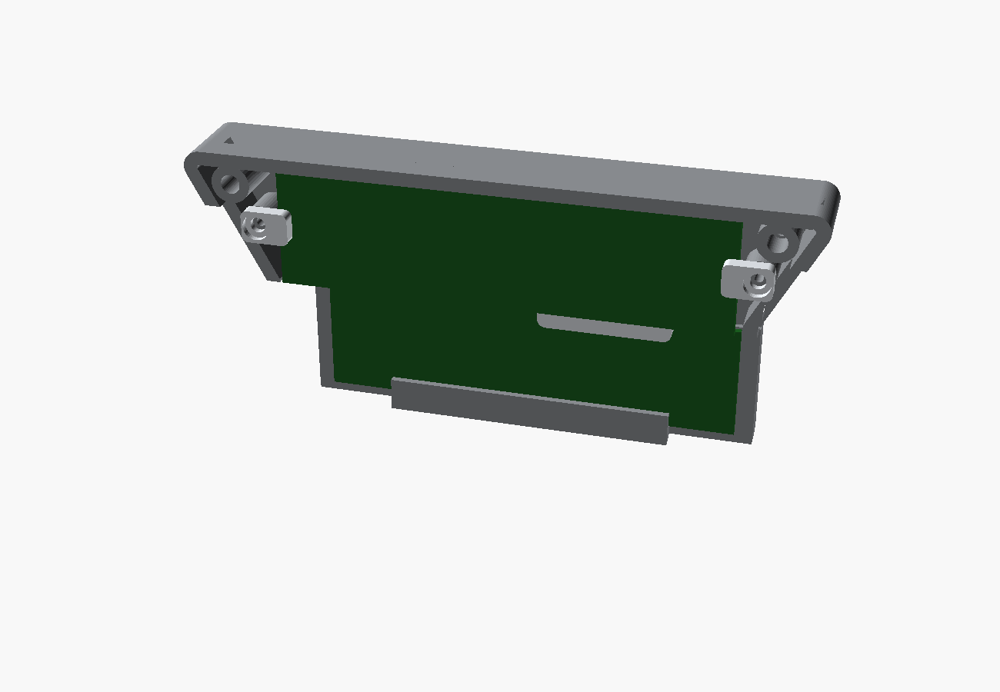

# Robot v4: assembly run book

One step at a time. Each step has the parts and hardware it needs, what to do, and a render of what it should look like.
Photos of the real build go in this folder, named `NN_what_it_shows.jpg`, and get added under the step they belong to.
Renders (`NN_render_*.png`) come from `parts/base_v4.scad` (`part = "head_view"`).

## Done

### Step 1: camera on the camframe ✅

Part: `base_camframe_v4.3mf` (superseded by the two-piece head, see step 2). The webcam PCB (Logitech 210-002028-003) is fitted to the camframe: lens in its square pocket, glass eyes in the D3 and D6 seats,
mic cans in their pockets. One side is held by an M2.5 x 12 bolt through the edge slot, the mic side is hot-glued.

*01: webcam PCB, rear: M2.5 screw through the edge slot, thermal pad, chips.*

*02: camera on the camframe from the front. USB cable leaves at the bottom.*

## Next

### Step 2: head: front piece, back piece, OLED, camera ⏭

**Parts (in `out/`):** `base_head_front_v6.3mf` (print front face down, no supports), `base_head_back_v6.3mf` (print front face down, tree supports under the axle stubs and the crank bracket),
`base_head_straps_v6.3mf` (2 camera straps + 1 OLED strap, flat). They replace `base_head_v4`, `base_camframe_v4`, `base_head_v5` and `base_plate_v4`; do not print those. Not printed yet.
**Hardware:** the camera with its glass eyes, the OLED (2.08", GME25664-65), 2 x M2.5 heat-set inserts (front piece), 1 x M3 heat-set insert (crank bracket on the back piece's left arm),
2 x **M2.5 x 10** (joint), 2 x **M2 x 6** (camera straps), 1 x **M2 x 5** (OLED strap), all M2 self-tapping into the printed pilot holes.
**Nothing more to print for this step.**

*03: front piece from the front: camera hole above the OLED window, the two eye holes (glass domes), visor on top.*

*04: the assembled head from the rear: back piece with its two ears (bolts), pivot arms and axle stubs.*

*06: back piece off: camera board held by a strap at each end, OLED below it, rim along its bottom edge, the two joint bosses in the top corners.*

*05: exploded, seen from the right: back piece, straps, camera board, OLED, front piece.*

1. **Inserts.** M2.5 inserts into the two joint bosses (top corners of the front piece, pressed in from the rear end). M3 insert into the crank bracket on the back piece's left arm.
2. **OLED.** Glass into the pocket from behind; the board's bottom edge goes under the rim (the lip along the bottom), then the board lies flat. Put the OLED strap over its top edge, **M2 x 5**, snug only.
   There are 9.8 mm behind the board for the Dupont plugs; the wires leave through the open bottom.
3. **Camera.** Lens cube through the square hole from behind, glass eyes pressed into their seats from the front (spigots are behind the board's two LEDs). One camera strap at each end of the board (**M2 x 6**).
   The USB cable leaves through the open bottom.
4. **Close.** Back piece on, its two ears onto the joint bosses, **2 x M2.5 x 10** from behind.
5. **Check.** Camera does not rock, OLED is flat against its window, cable has a free run out of the bottom.

Add your photos here: `07_front_piece_printed.jpg`, `08_oled_fitted.jpg`, `09_camera_fitted.jpg`, `10_head_closed.jpg`.

## After that (not detailed yet)

| Step | What | Parts still to print |
|---|---|---|
| 3 | Inserts in the turret (strap 2, cowl 2, covers 6) and hub (4) | none: `base_turret_v4.3mf` and `base_hub_v4.3mf` are printed |
| 4 | `base_hub_v4.3mf` and `base_turret_v4.3mf` on the pan stack, 4 x M3 x 8 | none |
| 5 | Tilt servo in its cradle, strap, crank on the horn | **`base_strap_v4.3mf`** (1); `base_crank_v4.3mf` is printed  |
| 6 | 608 bearings and the head into the cheeks | see the note below |
| 7 | Tilt rod (M3 rod, 2 rose joints) | none |
| 8 | XIAO, wiring, cheek covers, cowl | **`base_cover_v4.3mf`** (print 2); reprint `base_cowl_v4.3mf` only if you printed it before commit c652f5e |

**Note on step 6:** the head's printed axle stubs run from the arm through the whole cheek, and the cheeks leave a 1 mm gap, so the head cannot be put in once the cheeks are fixed. This needs a design change before step 6 (for example a separate axle pin).
