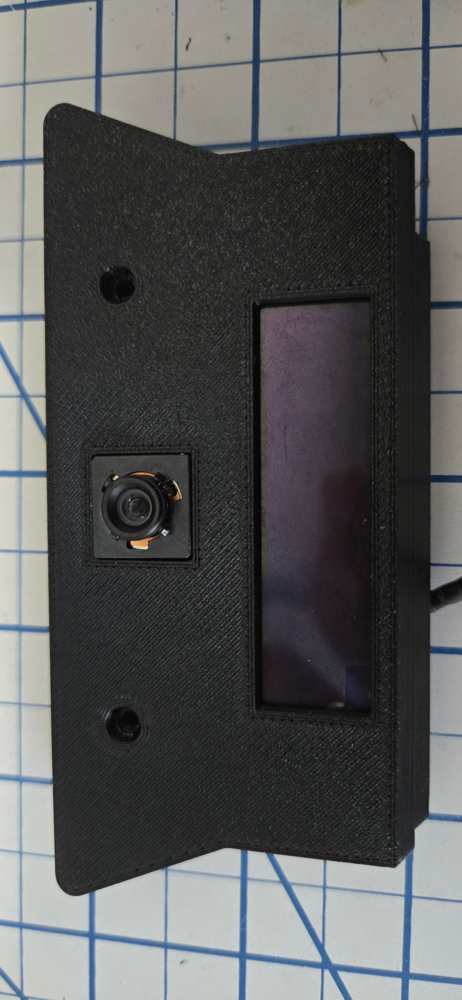
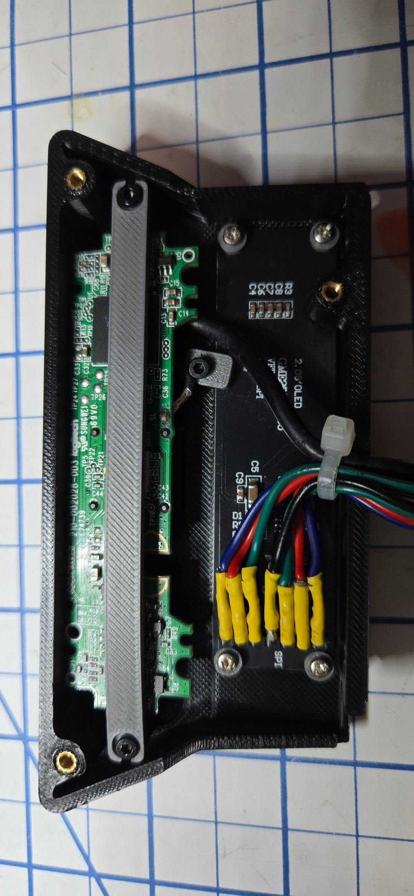

# Robot v4: assembly run book

One step at a time. Each step has the parts and hardware it needs, what to do, and a render of what it should look like.
Photos of the real build go in this folder, named `NN_what_it_shows.jpg`, and get added under the step they belong to.
Renders (`NN_render_*.png`) come from `parts/base_v4.scad` (`part = "head_view"`).

## Parts legend (what to print, and what NOT to)

## Done

### Step 1: camera on the camframe ✅

Part: `base_camframe_v4.3mf` (superseded by the two-piece head, see step 2). The webcam PCB (Logitech 210-002028-003) is fitted to the camframe: lens in its square pocket, glass eyes in the D3 and D6 seats,
mic cans in their pockets. One side is held by an M2.5 x 12 bolt through the edge slot, the mic side is hot-glued.

*01: webcam PCB, rear: M2.5 screw through the edge slot, thermal pad, chips.*

*02: camera on the camframe from the front. USB cable leaves at the bottom.*

### Step 2: head: front piece, back piece, OLED, camera ✅

**Parts (in `out/`):** `base_head_front_v6.3mf` (print front face down, no supports), `base_head_back_v6.3mf` (print front face down, tree supports under the axle stubs and the crank bracket),
`base_head_straps_v6.3mf` (1 long camera strap + 1 OLED half strap, flat). **Redesign 2026-11-14:** the printed axle stubs are gone; the back piece now has a D-shaped bore in each arm and a 0.8 mm spacer boss, and the axle is two separate pins, `base_axle_pin_v6.3mf` (print 2, identical, flat side down, lying on the bed). The back piece must be **reprinted**. They replace `base_head_v4`, `base_camframe_v4`, `base_head_v5` and `base_plate_v4`; do not print those. Printed and assembled (2026-11-14).
**Hardware:** the camera with its glass eyes, the OLED (2.08", GME25664-65), 3 x M2.5 heat-set inserts (front piece), 1 x M3 heat-set insert (crank bracket on the back piece's left arm),
2 x **M2.5 x 10** + 1 x **M2.5 x 8** (joint, the short one at the bottom right), 2 x **M2 x 6** (camera strap, one at each end), 4 x **M2 x 4** (OLED board) + 1 x **M2 x 5** (OLED half strap, optional extra), all M2 self-tapping into the printed pilot holes.
**Nothing more to print for this step.**

*03: front piece from the front (now with full side walls and floor, closed up to the back piece): camera hole above the OLED window, the two eye holes (glass domes), visor on top.*

*04: the assembled head from the rear: back piece with its two ears (bolts), pivot arms and axle stubs.*

*06: back piece off: camera board held by a strap at each end, OLED below it (four screws), the two joint bosses in the top corners.*

*05: exploded, seen from the right, front piece on the right. In order toward the rear: OLED (hidden behind the camera board here), camera board with lens, the straps, the back piece, and the two axle pins moved out to the sides.*

1. **Inserts.** M2.5 inserts into the three joint bosses (two top corners and one at the bottom right of the front piece, pressed in from the rear end). M3 insert into the crank bracket on the back piece's left arm.
2. **OLED.** Glass into the pocket from behind, the board lies flat on the wall, and four **M2 x 4** go through its corner holes into the printed pilots (snug only, the pilots are 3 deep in a 4 mm wall). The half strap (**M2 x 5**) is an optional extra over the top edge.
   There are 9.8 mm behind the board for the Dupont plugs; the wires leave through the cable slot in the back plate (50 x 9, bottom edge).
3. **Camera.** Lens cube through the square hole from behind, glass eyes pressed into their seats from the front (spigots are behind the board's two LEDs). The long camera strap across the back of the board, one **M2 x 6** at each end.
   The USB cable leaves through the same slot.
4. **Close.** Back piece on, onto the joint bosses, **2 x M2.5 x 10** at the top corners and **1 x M2.5 x 8** at the bottom, all from behind.
5. **Check.** Camera does not rock, OLED is flat against its window, cable has a free run out of the slot.

*07: the assembled head from the front (black PETG): lens in its square hole, OLED window at the right, the two eye holes (left side, the top one still open).*

*09: the head with the back piece off: OLED on its four screws with the Dupont header at the left, camera board under the long strap, the camera cable looping out at the bottom, M2.5 inserts in the corner and bottom joint bosses.*

Still to add: `10_head_closed.jpg`. Still open: a decorative lens shroud in a contrasting colour (not designed yet).

## Next

## After that (not detailed yet)

| Step | What | Parts still to print |
|---|---|---|
| 3 | Inserts in the turret (strap 2, cowl 2, covers 6) and hub (4) | none: `base_turret_v4.3mf` and `base_hub_v4.3mf` are printed |
| 4 | `base_hub_v4.3mf` and `base_turret_v4.3mf` on the pan stack, 4 x M3 x 8 | none |
| 5 | Tilt servo in its cradle, strap, crank on the horn | **`base_strap_v4.3mf`** (1); `base_crank_v4.3mf` is printed  |
| 6 | 608 bearings and the head into the cheeks | see the note below |
| 7 | Tilt rod (M3 rod, 2 rose joints) | none |
| 8 | XIAO, wiring, cheek covers, cowl | **`base_cover_v4.3mf`** (print 2); reprint `base_cowl_v4.3mf` only if you printed it before commit c652f5e |

**Step 6 (head into the cheeks), now resolved:** press a 608 into each cheek from the inner face, slide the head in from the front (the arms' spacer bosses sit 0.2 mm from the cheeks), then push one axle pin from the outside through each bearing into the D bore of the arm (flat side down, it only fits one way).
The pin's flange sits in the 12 mm lip bore against the bearing; the cheek cover (now flat, spigot removed, **reprint** `base_cover_v4.3mf` x 2) closes the bore and holds the pin in. No new inserts: the covers use the cheeks' existing M3 inserts.

*12: the two cheek covers pulled off the turret's cheeks (head and axle pins in place). Each cover is a flat 34 mm disc, 3.5 thick, held by 3 x M3 x 8 into the three M3 inserts in the cheek's outer face (bolt circle r 14); it also closes the bearing bore and holds the axle pin in.*
