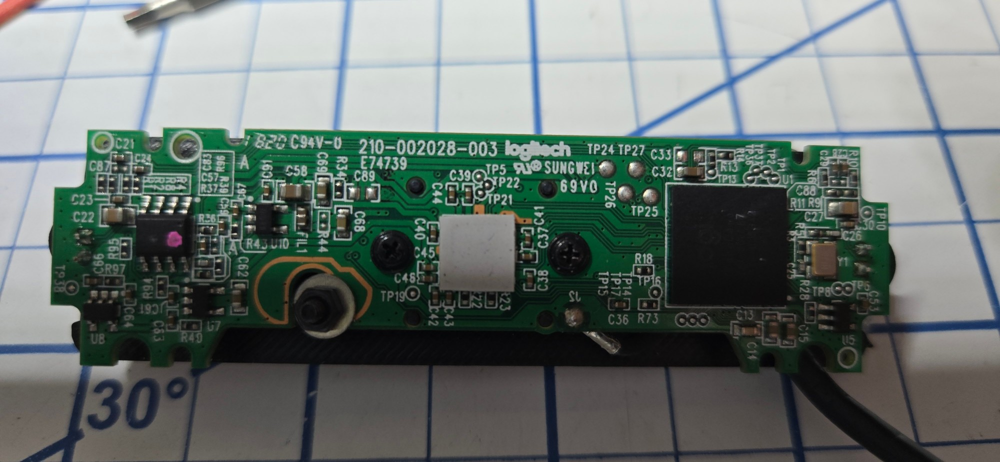

# Robot v4 head and turret: assembly run book

Order of work, with the parts and hardware each step needs. Photos live in this folder and are named `NN_what_it_shows.jpg`;
add each one under the step it belongs to. Models: [`parts/base_v4.scad`](../../parts/base_v4.scad), exports in `out/` (git-ignored).

Status key: ✅ done, ⏭ next, ⛔ blocked (see the note), ⬜ later.

## 0. Print list (grey PETG, Bambu A1)

| Part | File (`out/`) | Qty | Orientation | Status |
|---|---|---|---|---|
| Head (plate, arms, crank bracket) | `base_head_v4.3mf` | 1 | front face down | printed |
| Camframe (front cover with the LED eyes) | `base_camframe_v4.3mf` | 1 | front face down | printed, fitted (photo 02) |
| Crank (servo horn to rod) | `base_crank_v4.3mf` | 1 | horn face down | printed |
| Turret | `base_turret_v4.3mf` | 1 | floor face down | printed (must be the version with the 1 mm lip on the 608 pockets and the screws at r 36) |
| Hub | `base_hub_v4.3mf` | 1 | flange down | printed |
| **Tilt servo strap** | `base_strap_v4.3mf` | 1 | flat | **to print** |
| **Cheek covers** | `base_cover_v4.3mf` | 2 | face down, spigot up | **to print** |
| Cowl | `base_cowl_v4.3mf` | 1 | upside down on its flat top | reprint if it was printed before the covers were added (commit c652f5e changed its cheek notch) |

Not covered here: the pan stack (tub, lid, skirt, stand base), which `v4_tub`, `v4_lid` and `v4_skirt` print.

## 1. Hardware

| Item | Qty | Used for |
|---|---|---|
| M3 heat-set inserts (bore 4.3 x 5) | 16 | turret 10 (2 strap posts, 2 cowl posts, 6 cheek covers), hub 4, crank 1, head bracket 1 |
| M2.5 heat-set insert (bore 3.1 x 4.5) | 1 | boss on the rear of the head plate |
| M3 x 8 button-head screws | 14 | strap 2, cowl 2, covers 6, hub flange 4 |
| M2.5 x 16 screw | 1 | camframe + camera + plate (the 12 mm bolt in photo 02 only holds the camera on the frame for now) |
| M2 self-tapping screws, short | 4 | OLED board into the plate's pilot holes |
| M3 x 6 to 8 screws | 4 | crank onto the servo horn (PCD 14); check the horn's thread depth |
| M3 threaded rod, about 27 mm between pin centres, and 2 rose-joint rod ends | 1 set | tilt rod |
| M3 bolts and thread-locker | 2 | rod ends into the crank and head bracket |
| 608 bearings | 2 | cheek pockets |
| STS3215 servo (tilt) | 1 | cradle on the turret floor |
| Seeed XIAO ESP32-S3 | 1 | OLED driver, hot-glued into its pocket |
| Hot glue, zip tie | | XIAO, OLED wires |

## 2. Assembly

### 2.1 Camera on the camframe ✅

1. Fit the webcam PCB (Logitech 210-002028-003) to the camframe. The lens sits in its square pocket, the sawn-off glass eyes sit in the D3 and D6 seats, the mic cans sit in their pockets.
2. The M2.5 screw goes through the 4 mm edge slot in the board (photo 01). The mic side is hot-glued to the frame.

*01: webcam PCB, rear. M2.5 screw through the edge slot, thermal pad, chips.*

*02: camera on the camframe from the front. Glass eyes in the D3/D6 seats, lens in its pocket, USB cable leaving at the bottom.*

### 2.2 Inserts ⏭

Press all heat-set inserts in with the iron, cold parts, square to the surface. Do this before anything else goes together.

- Turret: strap posts (2, in the top faces), cowl posts (2, radial, from the outer face of each post), cheek covers (3 in each cheek's outer face).
- Hub: 4 in the flange's top face.
- Crank: 1 in the pin boss, from the free face. Head: 1 M3 in the crank bracket, 1 M2.5 in the rear boss of the plate.

Check each insert with a screw before you move on.

### 2.3 Head: OLED and camera ⏭

1. OLED (2.08", GME25664-65): glass into the pocket from the rear, PCB flat on the plate rear, 4 x M2 into the pilot holes. Route the wires down and zip-tie them at the tab above the board's left end.
2. Camera and camframe onto the plate front: **M2.5 x 16** through the frame tab and the board slot into the plate's insert. Check the clamp length: the frame's rear face stands 6.7 mm off the plate front, so a 12 mm screw would only grip about 2 mm of the insert.
3. Free the USB cable: it leaves at the bottom of the frame, over the cheeks and through the cowl's centre notch toward the hub hole.

### 2.4 Turret on the pan stack ⬜

1. Hub onto the pan servo horn and through the pillow block (stand build).
2. Turret on the hub flange: 4 x M3 x 8 through the floor at 35, 125, 215 and 305 degrees.
3. Cables from the pan stack come up the D-shaped hub hole.

### 2.5 Tilt servo ⬜

1. Servo into the cradle, horn side toward -X, its cable out through the right wall opening.
2. Strap over the servo top: 2 x M3 x 8 into the post inserts.
3. Crank onto the horn (4 x M3). Set the servo to its tilt-zero position before you fix the rod.

### 2.6 Bearings and head into the cheeks ⛔

1. Press a 608 into each cheek pocket from the inner face (the 1 mm outer lip stops it).
2. Head between the cheeks: the printed stubs on the arms go into the bearing bores.

**Blocker:** the stubs run from the arm (x 41) through the full cheek (to x 50), and the cheeks leave only a 1 mm gap, so the head cannot be lowered in or the stubs pushed in once the cheeks are fixed. Decide before assembling. Proposed fix: make the axle a separate pin. Bearings go in first, the head drops between the cheeks, then an 8 mm pin goes in from outside through each bearing into a socket in the arm, held by the cover.

### 2.7 Rod ⬜

Thread a rod end on each end of the M3 rod and bolt it to the crank pin and head crank pin (thread-locker). Check the range: head tilt -22 to +45 degrees, servo angles about 96 (at -22), 76 (0), 55 (+23).

### 2.8 Electronics and covers ⬜

1. XIAO in its pocket, hot glue, USB-C end toward the hub hole.
2. Wire the OLED to the XIAO, USB cable down the hub hole.
3. Cheek covers: spigot into the lip bore, 3 x M3 x 8 each.
4. Cowl from behind, then 2 x M3 x 8 radially from outside into the side posts. The camera cable passes the centre notch.

### 2.9 Test ⬜

Move the head through its full travel by hand before powering the servo. Check that nothing rubs: head against floor and cowl, rod against the cowl window, and the cable in the notch.
