# Robot v4: assembly run book

The build from the bottom up: the tub (electronics box), the lid with its wall, the pan stack, the turret, then the head.
Each step has the parts and hardware it needs, what to do, and a render or photo of what it should look like.
Photos of the real build go in this folder, named `NN_what_it_shows.jpg`, and get added under the step they belong to.
Renders (`NN_render_*.png`) come from `parts/base_v4.scad` (`part = "head_view"`). Wiring details are in `hardware/wiring.md`.

| Step | What | Status |
|---|---|---|
| 1 | Tub: feet, inserts, Orin, power, button, antennas | ✅ |
| 2 | Lid with its wall, servo adapter | ✅ |
| 3 | Pan stack, turret, tilt linkage and the head, onto the lid (render 34) | next |
| 4 | Head: front piece, back piece, OLED, camera | ✅ (built ahead; goes in at 3.8) |
| 5 | Head into the cheeks, cheek covers and ears | goes in at 3.8 |

## Parts legend (what to print, and what NOT to)

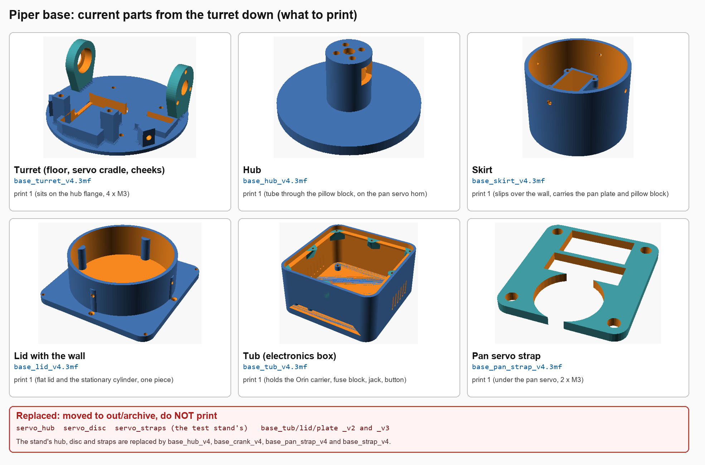

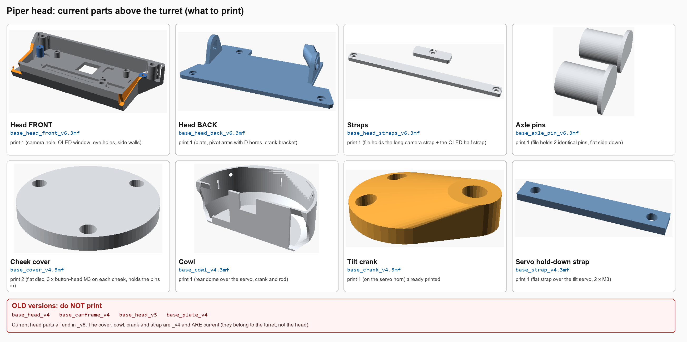

All superseded parts are in `out/archive/` (printable files) and `parts/archive/` or `parts/prototype/` (sources), so everything left in `out/` is current.

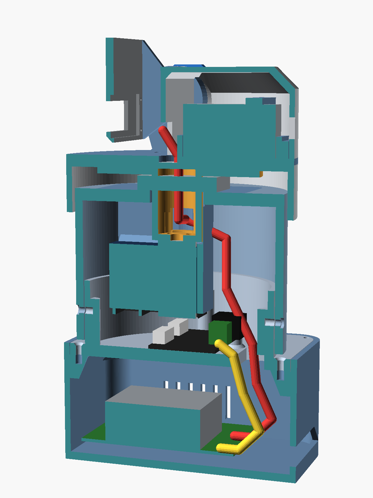
*22: cutaway of the whole stack, bottom to top: the Orin in the tub, the servo adapter on the lid inside the round wall, the pan servo, the turret and the head. Red: the head's cable up through the hub; yellow: the servo adapter's leads down through the lid's cable slot to the tub.*

---

# The base

## Step 1: tub ✅

**Part:** `base_tub_v4.3mf` (print 1). It holds the Orin carrier, the 12 V split terminal block, the DC jack and the power button.
**Hardware:** 4 x 1 inch rubber feet, 8 x M2.5 heat-set inserts (4 corner + 4 side bosses, for the lid), 1 x M3 heat-set insert (terminal block boss),
the 12 V DC jack, the 19 mm momentary power button (Geekworm T100, LED ring), two Wi-Fi antenna connectors, the split terminal block (2 poles of a uxcell X3-2012 strip) and 1 x M3 screw.

1. **Feet.** One rubber foot in each of the four 26 mm pockets under the corners.
2. **Inserts.** M2.5 into the eight bosses around the rim; M3 into the terminal block's boss in the power channel (the 32 mm gap between the Orin and the left wall).
3. **Back wall.** 12 V jack in its hole at the left of the port window, the two antenna connectors in the 6.5 mm holes above the window.
4. **Power button** in the 19.2 mm hole in the left wall; its two "ON" leads to pins 1 and 2 of the carrier's 12-pin button header.
5. **Orin.** Carrier onto its bosses, ports to the back wall in line with the port window. Orin power: a right-angle barrel plug in the carrier's DC jack.
6. **Power.** Jack + / − to the split block, the block to the carrier's DC jack and to the servo adapter (its leads go up through the lid's cable slot). The block's screws face up, so they can be tightened with the lid off.

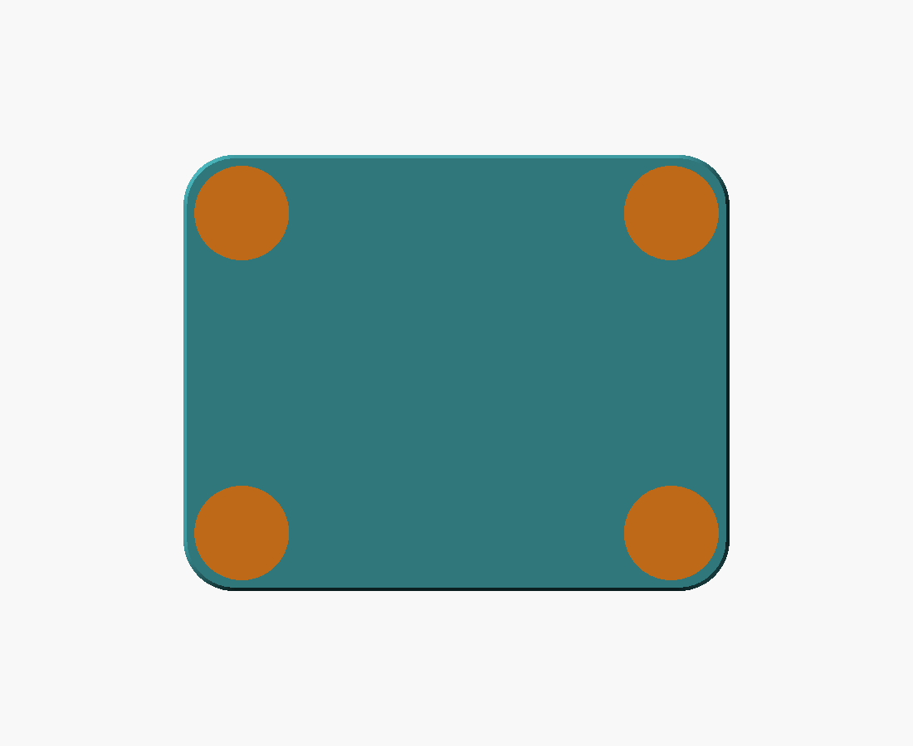
*28: the tub from below: four 26 mm x 2 mm pockets for 1 inch rubber feet.*

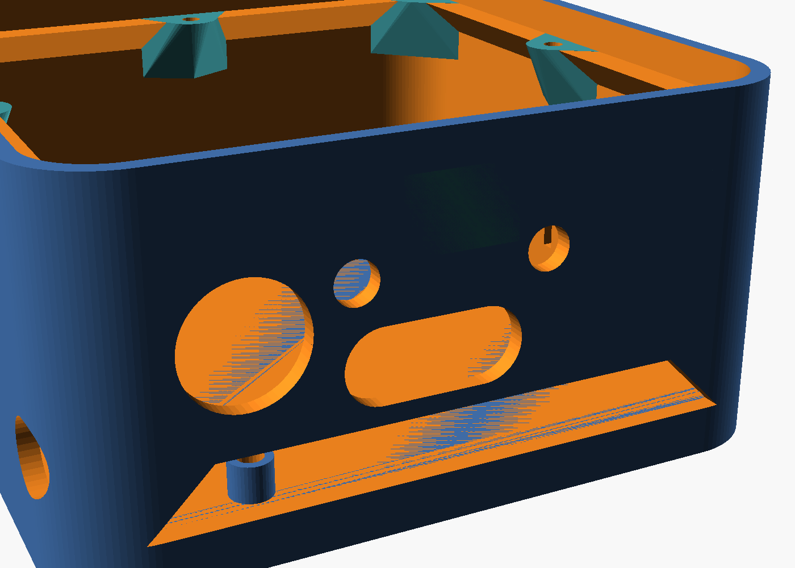
*25: the back wall: 12 V jack (bottom left), the full-height port window, the two antenna holes above it.*

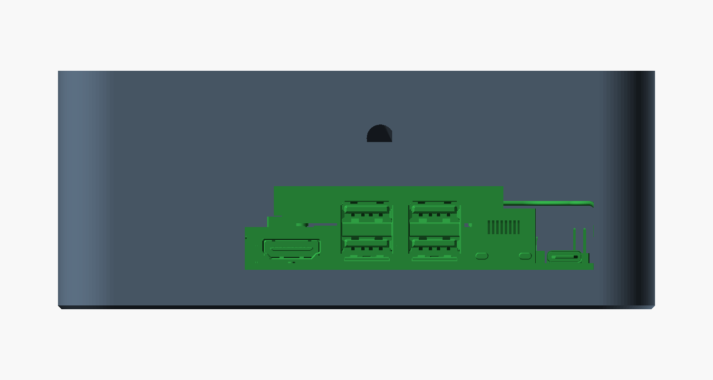
*29: the back wall from outside with the Orin carrier behind it: the window exposes HDMI to USB-C; the jack is at the left.*

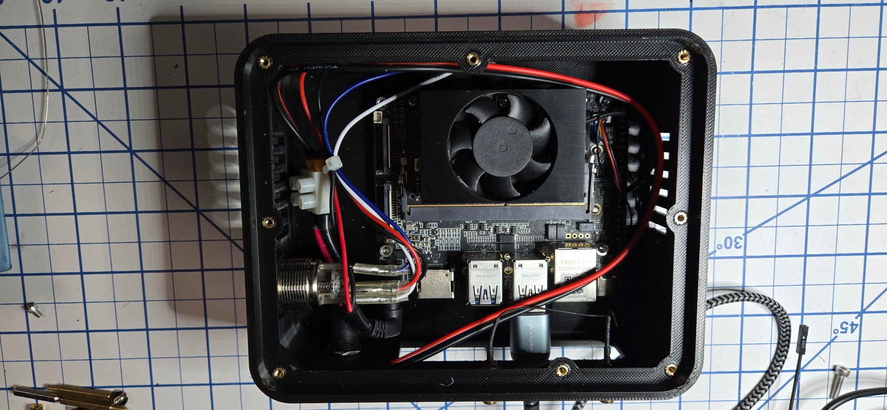
*31: the tub from above, lid off: the Orin NX with its fan, ports toward the back wall (bottom of the photo); the power button (metal, LED ring) and the 12 V jack at the lower left; the split terminal block (white, cable-tied) in the power channel on the left; the red / black 12 V leads to the servo adapter looping around the Orin; brass M2.5 inserts in the bosses around the rim.*

## Step 2: lid with its wall, servo adapter ✅

**Part:** `base_lid_v4.3mf` (print 1: flat lid and the stationary round wall, one piece, with the adapter's four standoffs).
**Hardware:** the Waveshare Bus Servo Adapter (A), 4 x M2.5 heat-set inserts (standoff tops) + 4 x M2.5 x 6, M2.5 screws into the tub's eight inserts, M2.5 heat-set inserts in the wall's columns (for the skirt).

1. **Inserts** into the four standoff tops and the wall's insert columns.
2. **Servo adapter** on its standoffs: long side across, power edge (USB-C, DC terminal, jack) to the back beside the cable slot, servo connectors to the front. Power goes in on the DC screw terminal; the barrel jack stays unused.
3. **Leads.** The adapter's power and USB leads go down the cable slot to the tub; its servo lead waits for the pan servo (step 3).
4. **Close.** Lid onto the tub, screws into the eight inserts.

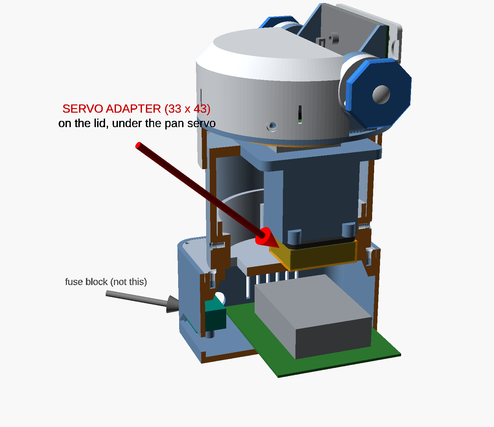
*19: the bus servo adapter (orange) lies on the lid, inside the round wall, under the pan servo. Its power and USB leads go down the lid's cable slot; its servo lead goes up to the pan servo, and the tilt servo chains off the pan servo's second connector.*

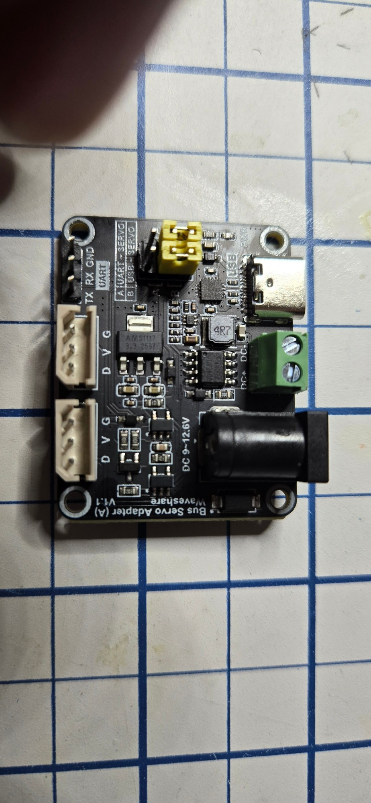
*20: the Waveshare Bus Servo Adapter (A), 33 x 43 mm. Mounting holes: 2.5 mm on a 27.5 x 37 pattern (checked with `parts/prototype/adapter_hole_coupon.scad`). Left long edge: two servo connectors and the UART header; right long edge: USB-C, the DC screw terminal and the 9-12.6 V barrel jack.*

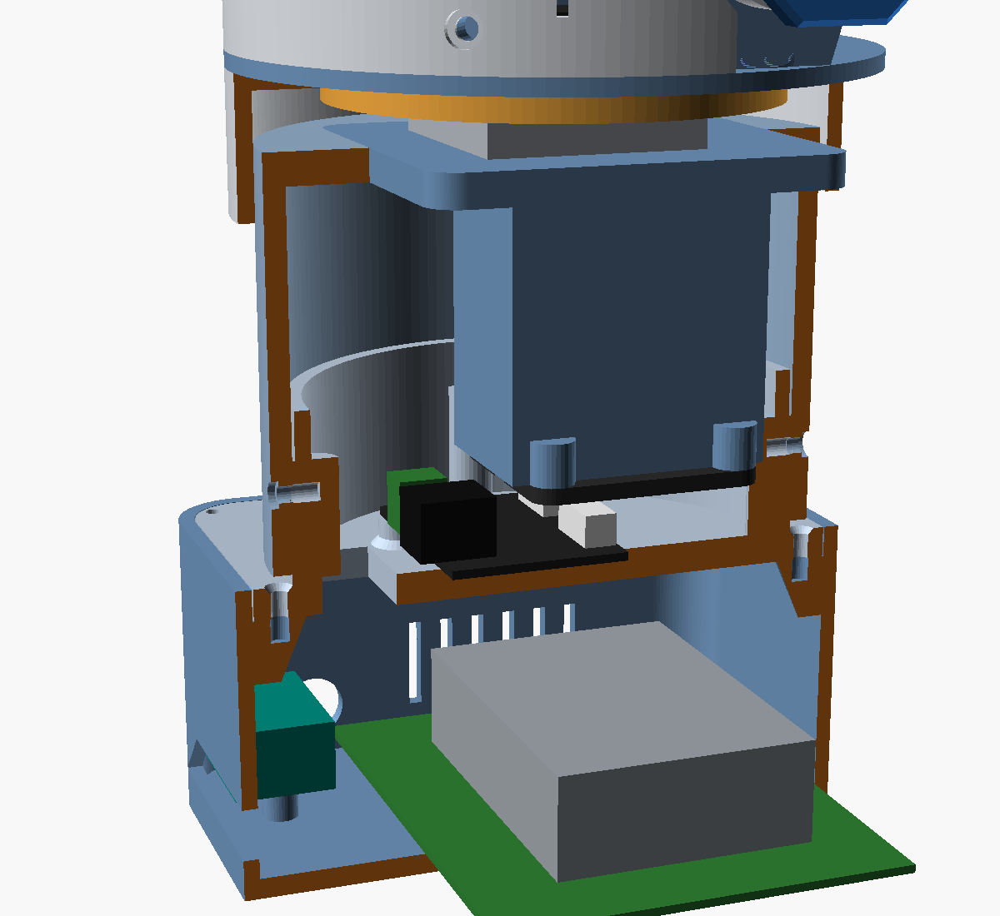
*21: the adapter on four 5 mm standoffs printed with the lid: long side across, power edge to the back beside the cable slot, servo connectors to the front under the pan servo's strap (3 mm clear).*

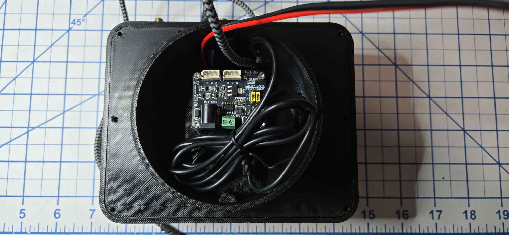
*33: the lid from above: the servo adapter on its standoffs inside the round wall; the 12 V leads (red / black) and the braided USB cable come up through the cable slot at the back; spare cable coiled for now.*

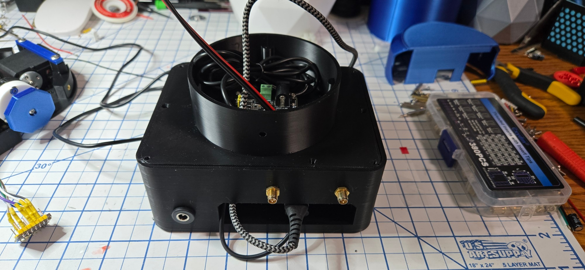
*32: the base closed, from the back: lid and round wall on the tub; on the back wall the 12 V jack (left), the two antenna connectors and the port window with the USB cables leaving it.*

## Step 3: pan stack, turret, tilt linkage, onto the lid

Everything above the lid is built **on the bench as one unit** and lowered onto the lid last. Three things force the order:
the hub's four screws into the pan servo's horn are driven *down the open hub tube*, so the hub goes on before the turret;
the servo plugs are on the pan servo's *bottom* face, out of reach once the skirt is over the wall;
and the head's cables come out of the hub's window *inside* the skirt, so they have to be fed down before the skirt goes on.

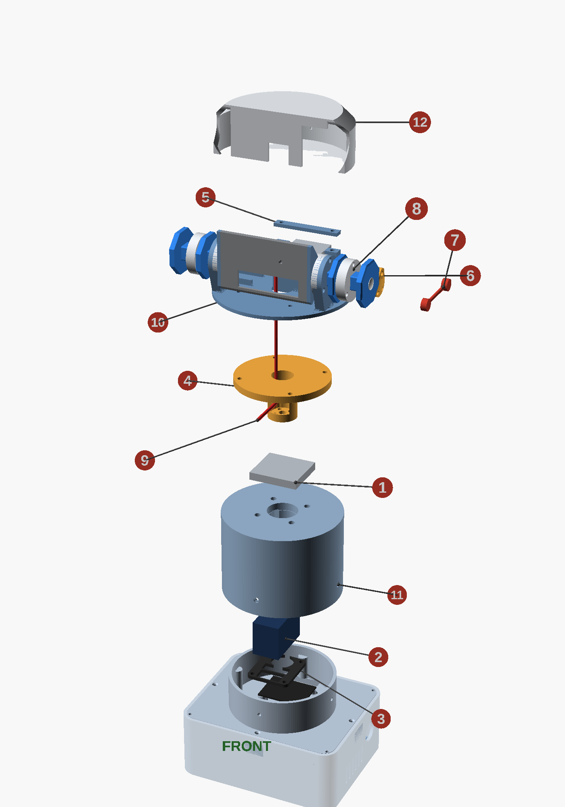
*34: this step exploded, bottom to top; the numbers are the sub-steps below. Red line: the cables' way down the turret floor hole and the hub, out of its window toward the front.
Source: `34_turret_to_lid_exploded.scad` (in this folder).*

**Parts:** `base_skirt_v4.3mf`, `base_pan_strap_v4.3mf`, `base_hub_v4.3mf`, `base_turret_v4.3mf`, `base_strap_v4.3mf` (tilt servo strap), `base_crank_v4.3mf`, `base_cowl_v4.3mf` (the 2026-11-15 version), the head (step 4), the cheek covers, ears and plugs (step 5).
**Bought:** ServoCity 1" pillow block, 2 x STS3215 (ID 1 = pan, ID 2 = tilt), M3 threaded rod + 2 M3 rose-joint rod ends + 2 jam nuts, 2 x 608 bearings.
**Screws** (lengths marked ~ are estimates: check before driving them home): 4 x M4 (pillow block), M3 x 8 (pan strap), 4 x short M3 ~6 (hub into the horn: they must not bottom out in the horn),
2 x M3 x 8 (tilt strap), 4 x short M3 ~6 (crank onto the tilt horn), 2 x M3 ~10 (rod ends), 4 x M3 x 8 (turret onto the hub flange), 4 x M2.5 ~8 (skirt into the wall), 2 x M3 x 8 button head (cowl).
**On the bench:** the servo adapter powered and on USB, with `tools/servo_test` to switch a servo's torque off (`py goto.py --id N --release`) so it turns by hand.

**The pan stack**

1. **Pillow block** onto the skirt's plate: skirt upside down, block on the top face, 4 x M4 into the plate's inserts.
2. **Pan servo** up into the sleeve from below: shaft up on the bearing's axis, the body running toward the **front** (the sleeve's open end), case top pressed against the stop rails.
   First plug the lead from the servo adapter into one of its two bottom sockets (the other is for the tilt servo, 3.10).
   The sleeve is **52.6 mm deep and the servo case only 32**: the servo does *not* go up to the plate. It stops on two stop rails on the sleeve's side walls, 20.6 mm below the plate,
   which leaves room above it for the horn, the hub's closed end and the hub's cable window. Its bottom then sits flush with the sleeve's bottom edge, where the strap goes.

   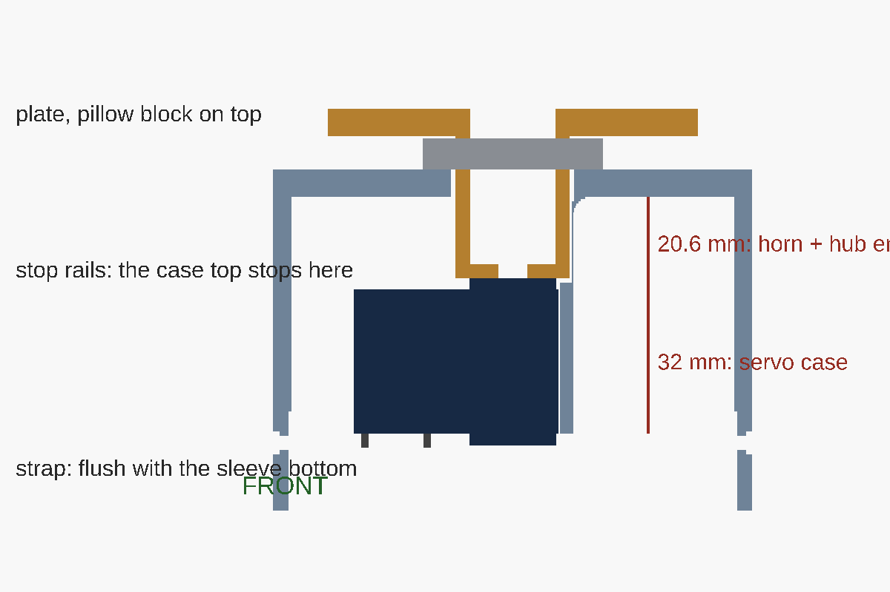
   *35: section along the pan servo (front to the left): plate and pillow block on top, the hub's closed end on the horn, the servo case against the stop rails, the strap flush with the sleeve's bottom.*
3. **Pan strap** under the servo, M3 into the inserts; the plugs come out through the strap's cutout.
4. **Hub.** Pan servo torque off. Hub down through the bearing onto the horn with its **cable window facing the front** (over the top of the pan servo, toward the sleeve's open end:
   the sleeve is closed round the hub on the other three sides). 4 x M3 down the open tube through the hub's floor into the horn. The flange should rest on the bearing and the hub turn freely.

**The turret**

5. **Tilt servo** in its cradle: plug its lead into its bottom socket first (it leaves through the cradle's open end toward the hub hole), then the strap across its top, 2 x M3 x 8.
   **XIAO** hot-glued into its pocket, USB-C toward the hub hole.
6. **Crank** onto the tilt servo's horn, 4 x M3. Torque off, then turn the horn so the crank points **up, leaning about 15 degrees forward** (its position with the head level).
7. **Tilt rod:** the two rod ends on the M3 rod, **27 mm eye centre to eye centre**, jam nuts snug. One eye onto the crank's pin: M3 through the eye into the crank's insert, from outside.
8. **Head into the cheeks** (608s, axle pins, covers, ears: step 5), then the rod's other eye onto the head's crank bracket: M3 through the eye into the bracket's insert (a ball-end hex key between arm and cheek helps).
   **Check by hand** (tilt servo torque off): the head swings nose-down to nose-up smoothly, and is level with the crank up-and-forward; if not, change the rod's length a turn at a time.

**Cables and joining**

9. **Cables down the hub:** the camera's USB cable, the XIAO's USB cable and the tilt servo's lead, plug end first, down through the turret floor's hole, down the hub tube and out of the window
   (its chamfers turn a plug fed down outward). Biggest plug first. Leave slack above for the tilt and pan.
10. **Turret onto the hub flange**, the head facing the same way as the hub's window (front), 4 x M3 x 8 from above into the flange's inserts. Pull the slack through the window, forward over the pan servo,
    and plug the **tilt servo's lead into the pan servo's second socket**.
    **Pan check:** turn the turret slowly by hand to each side and watch the window: the cables must slide, not pinch between the hub and the sleeve. Note how far it turns freely; the Orin
    allows +-90 degrees (`head.servos.pan_limits`): lower that if the cables tighten sooner.
11. **Onto the lid:** the USB cables down through the lid's cable slot into the tub (to the Orin's ports), then the skirt over the wall (its grooves over the wall's four insert columns), the sleeve's open end to the front.
    4 x M2.5 radially through the skirt into the column inserts.
12. **Cowl** over the back of the turret, 2 x M3 x 8 button head from outside into the posts' inserts.

**Last: centre and limits.** The servos' stored centre and tilt limits were set on the old test stand, with a different linkage, so set them again:

- Torque off both, hold the head **level and facing front**, then `py centre_here.py 1` and `py centre_here.py 2` (this pose becomes 2048 on both).
- Move the tilt in small steps (`py goto.py --id 2 <deg>`) nose-down and nose-up to just short of any contact (floor, cowl window, cheeks). Put the two angles in `LIMITS[2]` in `tools/servo_test/sts.py` and run `py set_limits.py 2`.
- On the Orin (`piper_assistant` config `head.servos`): the same `tilt_limits`, and `home` back to `[0, 0]` (it is `[0, -33]` for the old stand).

---

# The head

**Inserts first:** turret (tilt strap 2, cowl 2, cheek covers 6), hub flange (4). Still to print for step 3: **`base_strap_v4.3mf`** (1), **`base_cover_v5.3mf`** (2), **`base_ear_v5.3mf`** (2), **`base_plug_v5.3mf`** (1, holds 2); **`base_cowl_v4.3mf`** was updated 2026-11-15 (cheek-cutout tips removed, 3 mm inner fillet on the front wall): print this version, not an older one.

## Step 4: head: front piece, back piece, OLED, camera ✅

**Camera on the camframe (first try, kept for the record).** Part: `base_camframe_v4.3mf` (superseded by the two-piece head). The webcam PCB (Logitech 210-002028-003) is fitted to the camframe: lens in its square pocket, glass eyes in the D3 and D6 seats,
mic cans in their pockets. One side is held by an M2.5 x 12 bolt through the edge slot, the mic side is hot-glued.

*01: webcam PCB, rear: M2.5 screw through the edge slot, thermal pad, chips.*

*02: camera on the camframe from the front. USB cable leaves at the bottom.*

**Parts (in `out/`):** `base_head_front_v6.3mf` (print front face down, no supports), `base_head_back_v6.3mf` (print front face down, tree supports under the axle stubs and the crank bracket),
`base_head_straps_v6.3mf` (1 long camera strap + 1 OLED half strap, flat). **Redesign 2026-11-14:** the printed axle stubs are gone; the back piece now has a D-shaped bore in each arm and a 0.8 mm spacer boss, and the axle is two separate pins, `base_axle_pin_v6.3mf` (print 2, identical, flat side down, lying on the bed). The back piece must be **reprinted**. They replace `base_head_v4`, `base_camframe_v4`, `base_head_v5` and `base_plate_v4`; do not print those. Printed and assembled (2026-11-14).
**Hardware:** the camera with its glass eyes, the OLED (2.08", GME25664-65), 3 x M2.5 heat-set inserts (front piece), 1 x M3 heat-set insert (crank bracket on the back piece's left arm),
2 x **M2.5 x 10** + 1 x **M2.5 x 8** (joint, the short one at the bottom right), 2 x **M2 x 6** (camera strap, one at each end), 4 x **M2 x 4** (OLED board) + 1 x **M2 x 5** (OLED half strap, optional extra), all M2 self-tapping into the printed pilot holes.

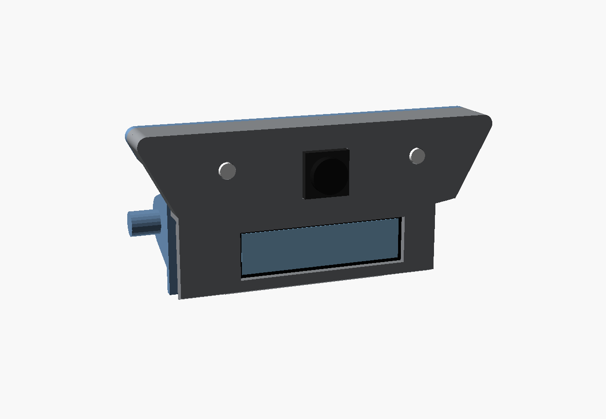
*03: front piece from the front (now with full side walls and floor, closed up to the back piece): camera hole above the OLED window, the two eye holes (glass domes), visor on top.*

*04: the assembled head from the rear: back piece with its two ears (bolts), pivot arms and axle stubs.*

*06: back piece off: camera board held by a strap at each end, OLED below it (four screws), the two joint bosses in the top corners.*

*05: exploded, seen from the right, front piece on the right. In order toward the rear: OLED (hidden behind the camera board here), camera board with lens, the straps, the back piece, and the two axle pins moved out to the sides.*

1. **Inserts.** M2.5 inserts into the three joint bosses (two top corners and one at the bottom right of the front piece, pressed in from the rear end). M3 insert into the crank bracket on the back piece's left arm.
2. **OLED.** Glass into the pocket from behind, the board lies flat on the wall, and four **M2 x 4** go through its corner holes into the printed pilots (snug only, the pilots are 3 deep in a 4 mm wall). The half strap (**M2 x 5**) is an optional extra over the top edge.
   There are 9.8 mm behind the board for the Dupont plugs; the wires leave through the cable slot in the back plate (50 x 9, bottom edge).
3. **Camera.** Lens cube through the square hole from behind, glass eyes pressed into their seats from the front (spigots are behind the board's two LEDs). The long camera strap across the back of the board, one **M2 x 6** at each end.
   The USB cable leaves through the same slot.
4. **Close.** Back piece on, onto the joint bosses, **2 x M2.5 x 10** at the top corners and **1 x M2.5 x 8** at the bottom, all from behind.
5. **Check.** Camera does not rock, OLED is flat against its window, cable has a free run out of the slot.

*07: the assembled head from the front (black PETG): lens in its square hole, OLED window at the right, the two eye holes (left side, the top one still open).*

*09: the head with the back piece off: OLED held by four self-tapping screws (2 mm x 6 mm) with printed washers under the heads, wires soldered and heat-shrunk to the OLED's SPI pads, cable-tied, camera board under the long strap, M2.5 inserts in the corner and bottom joint bosses.*

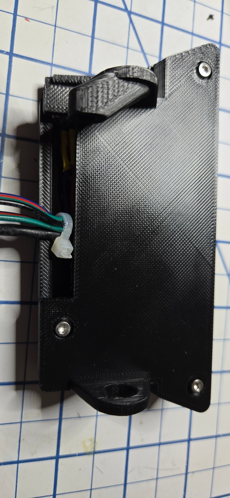
*10: the head closed from the rear: back piece on with three bolts, OLED and camera cables leaving through the slot at the left.*

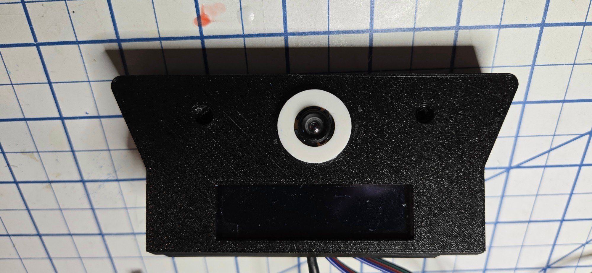
*11: the finished head from the front: white lens flange super-glued to the front face around the lens, OLED window below.*

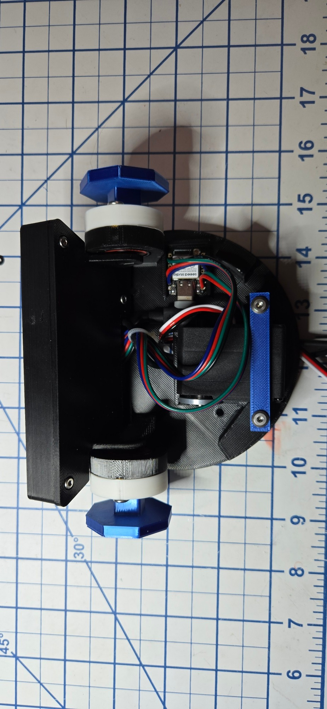
*23: the assembled head.*

**OLED washers:** `out/oled_washers_x4.3mf`: 4 washers, 2.4 hole, 5.0 OD, 1.8 thick, under the OLED screw heads.

**Lens flange (fitted):** `out/lens_flange.3mf` (source `parts/lens_flange.scad`): 20 mm ring, 11.2 mm hole (clears the four lugs on the lens), 1.8 mm thick, no notches. Print flat in blue or white, fixed with super glue (printed in white, fitted).

## Step 5: head into the cheeks, cheek covers and ears

Press a 608 into each cheek from the inner face, slide the head in from the front (the arms' spacer bosses sit 0.2 mm from the cheeks), then push one axle pin from the outside through each bearing into the D bore of the arm (flat side down, it only fits one way).
The pin's flange sits in the 12 mm lip bore against the bearing; the cheek cover (flat, 8 mm thick, **new** `base_cover_v5.3mf` x 2, replaces `base_cover_v4`) closes the bore and holds the pin in. It uses the cheeks' existing M3 inserts, plus one new M3 heat-set insert in the middle of each cover for the ear.

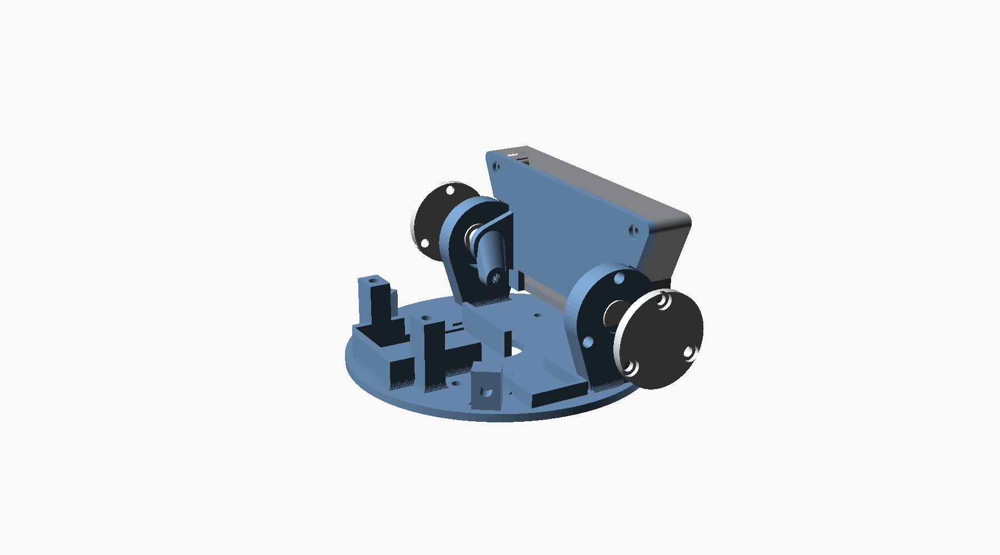
*12: the two cheek covers, each with its ear, pulled off the turret's cheeks (head and axle pins in place). Each cover is a flat 34 mm disc, 8 mm thick, held by 3 x button-head M3 x 12 (heads sit on the surface, no counterbore) into the three M3 inserts in the cheek's outer face (bolt circle r 14); it also closes the bearing bore and holds the axle pin in.*

### Ears (decorative)

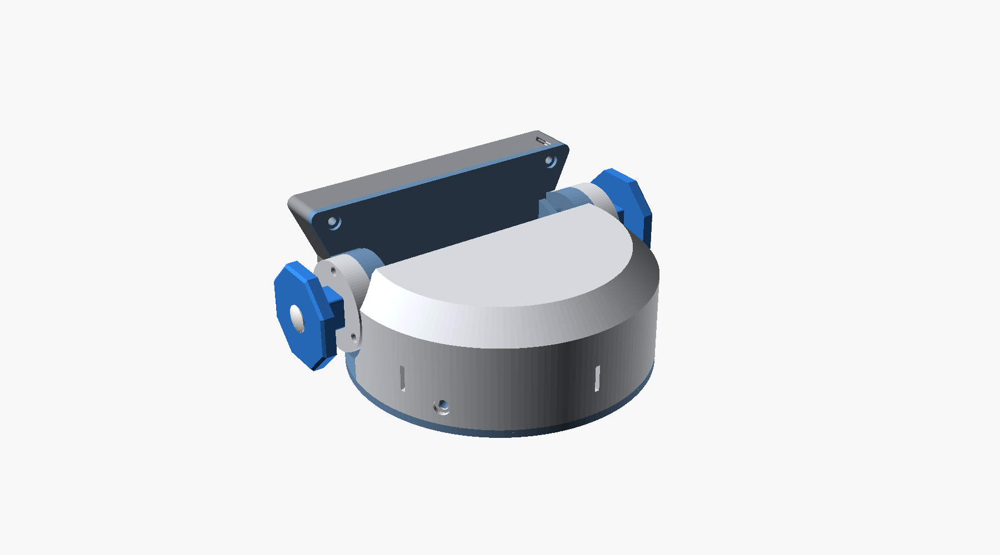
*15: the ears fitted: a 12 mm square stalk from the centre of each cover ending in a 36 mm octagonal disc (print blue or white). The covers are fixed to the turret, so the ears do not nod with the head.*

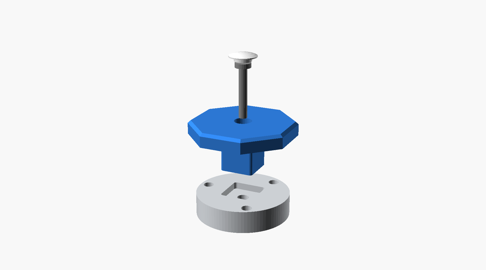
*16: one ear unit exploded, bottom to top: cover (square pocket and M3 insert in its centre), ear (square stalk sits in the pocket, so the octagon cannot turn), M3 x 18 button-head screw through the centre of the ear into the insert, domed plug glued over the screw head.*

**Parts:** `base_cover_v5.3mf` x 2 (print inner face down, pocket up), `base_ear_v5.3mf` x 2 (print octagon face down, stalk up, no supports), `base_plug_v5.3mf` (one file, 2 plugs, stem down, dome up).
**Hardware:** 2 x M3 heat-set insert (one in each cover's centre, pressed in from the pocket floor), 2 x M3 x 18 button head (ears), 6 x M3 x 12 button head (covers). Assembly: insert the M3 in each cover, push the ear's stalk into the pocket, screw the ear on, glue the plug over the head, then fit the cover on the cheek with its three screws.
Draft clash-checked against the head (tilt -22 to 45 deg) and the cowl: clear. Source: `base_v4.scad` (`cover4`, `ear4`, `plug4`; `part = "v4_cover" | "v4_ear" | "v4_plug"`).
