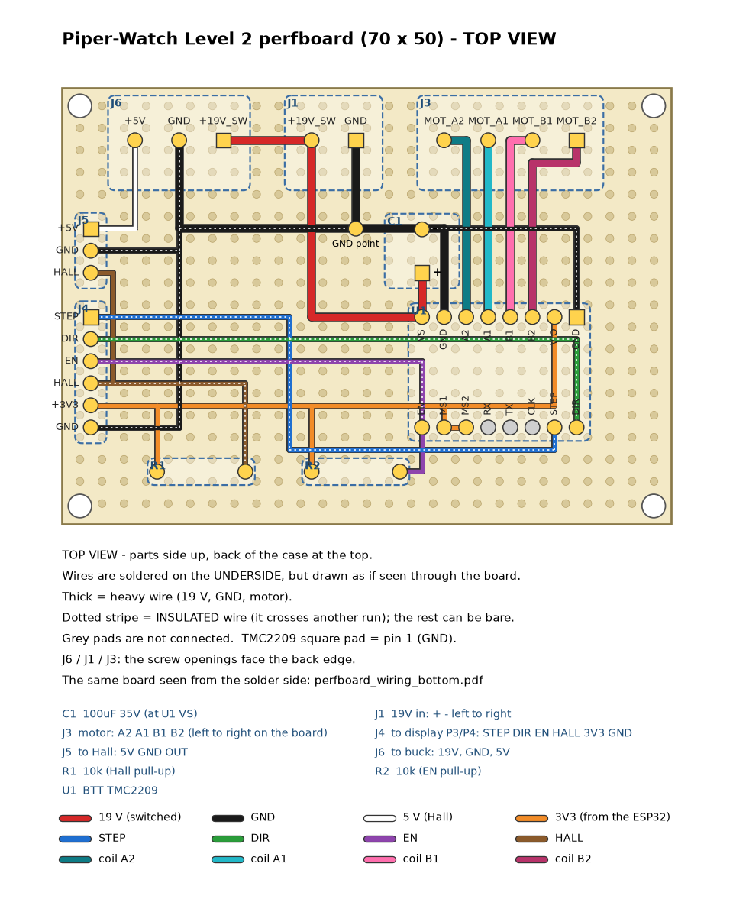

# Wiring

Two boards carry Piper-Watch's wiring: the **perfboard** on Level 2's floor (stepper driver and
power) and the **XIAO ESP32-S3** in the head (the three displays). The stepper and the Hall sensor
are run by the ESP32-S3 built into Level 2's front **display** (Guition JC4827W543R) - there's no
separate base ESP32. Everything talks to the Jetson over USB; no Wi-Fi or Bluetooth is used, so the XIAO's external antenna stays unplugged (the radio
is never turned on).

> The top-level README's electrical section describes the earlier servo design (USB hub, LED
> ring). This file is the current design.

## Overview

```text
 BACK PANEL / FLOOR (back-left)                       PERFBOARD (70 x 50, Level 2 floor)
 19 V ── jack ──► FLOOR SPLIT BLOCK (always on) ──┬──► spade leads ──────────────────────► Jetson DC in
                                                  └──► panel FUSE (3 A slow) ──► rocker SWITCH ──► J1 + ──► VM rail
                                                                                                     ├─ TMC2209 VM (+100 µF) ──► J3 ──► NEMA17
                                                                                                     └─ J6 19V/GND ──► LM2596 buck (floor) ──► J6 5V
        split block − = the COMMON GROUND (jack −, Jetson −, perfboard J1 −)

 USB to the Jetson (data, and power for the boards' logic):
   • head XIAO ESP32-S3   - eyes + mouth          (through the turntable's hollow)
   • C920 camera board    - original cable        (through the turntable's hollow)
   • JC4827 display       - front screen, stepper, Hall sensor  (Level 2's front wall)
```

The 19 V is split by a screw terminal block screwed to Level 2's floor: one pair of spade leads goes to the Jetson; the other goes through the panel fuse and the switch (both on the back panel, right beside the block) to the perfboard's J1. The fuse and switch cover **only the head side**  (stepper and buck), and the fuse can be changed from outside. The Jetson's feed never passes through the perfboard or the switch, so switching the head off never pulls the Jetson's power; it's protected by the 19 V supply's own current limit.

All grounds are common. The system's **common ground** is the split block's − terminal: the jack's −, the Jetson's − and the perfboard's J1 − all land there. On the perfboard, one ground point (★) gathers the board's grounds and returns to the split block through J1 −: the buck's input and output, the TMC2209's motor and logic grounds, and the display's GND (through J4). The ground is never switched or fused.

---

## 1. Perfboard: stepper driver + power (Level 2 floor)

The perfboard carries the TMC2209 and the terminals; one switched, fused 19 V feed comes in on J1. The buck is the larger Seloky LM2596S (66 × 36, with voltmeter) on its own M3 bosses beside it, wired to J6. The perfboard sits on four M2.5 inserts (holes 66 × 46).

### Power

| From                   | To                                                               | Notes                                                                                                                                |
| ---------------------- | ---------------------------------------------------------------- | ------------------------------------------------------------------------------------------------------------------------------------ |
| Jack + / −             | floor split block + / −                                          | 16–20 AWG, spade terminals (M3.5 screws); the Jetson's spade leads land here too                                                     |
| Split block +          | panel fuse holder (6 × 30 mm, **3 A slow-blow**) → rocker switch | 20 AWG; block to the holder's **end** contact, its **side** contact to the switch, so the exposed end of an unscrewed cap isn't live |
| Switch                 | J1 + → perfboard **VM rail**                                     | 20 AWG                                                                                                                               |
| Split block −          | J1 − → the board's ground point (★)                              | 20 AWG; the split block's − is the **common ground**                                                                                 |
| VM rail                | TMC2209 **VM**                                                   | short, 20–22 AWG                                                                                                                     |
| VM rail ↔ board ground | **100 µF / 35 V** electrolytic (35 V minimum; 50 V gives more margin)             | right at the driver's VM/GND pins, polarity!                                                                                         |
| VM rail / board ground | J6 **19V / GND** → LM2596 **IN+ / IN−**                          |                                                                                                                                      |
| LM2596 **OUT+**        | J6 **5V** → perfboard **5 V rail** (Hall only)                   | **set to 5.0 V with a meter before connecting anything**; OUT− is the same as IN−                                                    |

### Layout (70 × 50 perfboard) and parts

Top view, back of the case at the top. Power and motor leads land on screw terminals (J1, J3, J6);
the low-current logic (J4 to the display's ESP32, J5 to the Hall sensor) plugs onto 2.54 mm pin headers with
multi-pin Dupont housings. Everything is along the back and left edges only (the front faces the
display; the right edge is 2.5 mm from the wall).



Drawn to scale from `kicad/piper-watch.kicad_pcb` (KiCad checks it against the schematic). Top view,
back of the case at the top; wires are soldered underneath but drawn as seen from the top.

- **Back edge**, left to right: J6 (5V, GND, 19V), J1 (+, −) - the two 19 V screws side by side -
  and J3 (A2, A1, B1, B2). The screw openings face the back edge.
- **Left edge**, top to bottom: J5 (Hall: 5V, GND, OUT) right under J6's 5V, then J4 (STEP, DIR, EN,
  HALL, 3V3, GND). Pin 1 (square pad) is at the top of each.
- **TMC2209** under J3 with its power row on top (VS, GND, A2, A1, B1, B2, VIO, GND left to right):
  the coil wires go straight up to J3. C1 sits right above VS; the board's ground point is just
  under J1's −.

### Point-to-point wiring list

One row per piece of wire, exactly as drawn in the pictures (`kicad/perfboard_wiring_bottom.pdf`
is the solder side, `kicad/perfboard_wiring.pdf` the parts side). Heavy = 20–22 AWG (19 V, ground
and motor current); light = 24–30 AWG (logic). **Insulated** wires cross another run; the rest can
be bare solid wire. A piece that joins more than two pads is one wire soldered at each pad in turn
(or a short wire per hop). Lengths are along the holes, without the bends into the pads. TMC2209
pins are its female header's solder pins, named as on the BTT board: VS = motor supply (VM), VIO =
logic supply, A1/A2 = one coil, B1/B2 = the other.

<!-- wires:start (generated by hardware/kicad/tools/plot_perfboard.py - don't edit by hand) -->
| # | Net (colour in the pictures) | Wire | Joins | Length |
|---|---|---|---|---|
| 1 | 19 V (switched) | heavy, bare | J6 19V · J1 19V · C1 + · U1 VS | ~48 mm |
| 2 | GND | heavy, bare | J1 GND · GND point · C1 - · U1 GND | ~30 mm |
| 3 | GND | heavy, **insulated** | J6 GND · GND point · J5 GND · J4 GND | ~74 mm |
| 4 | coil A2 | heavy, bare | J3 A2 · U1 A2 | ~23 mm |
| 5 | coil A1 | heavy, bare | J3 A1 · U1 A1 | ~20 mm |
| 6 | coil B1 | heavy, bare | J3 B1 · U1 B1 | ~23 mm |
| 7 | coil B2 | heavy, bare | J3 B2 · U1 B2 | ~25 mm |
| 8 | GND | light, **insulated** | C1 - · U1 GND | ~28 mm |
| 9 | 5 V (Hall) | light, bare | J6 5V · J5 5V | ~15 mm |
| 10 | 3V3 (from the ESP32) | light, bare | U1 VIO · J4 3V3 · U1 MS1 · U1 MS2 · R1 (pin 1) · R2 (pin 1) | ~84 mm |
| 11 | STEP | light, **insulated** | J4 STEP · U1 STEP | ~71 mm |
| 12 | DIR | light, **insulated** | J4 DIR · U1 DIR | ~66 mm |
| 13 | EN | light, **insulated** | J4 EN · U1 EN | ~46 mm |
| 14 | EN | light, bare | U1 EN · R2 (pin 2) | ~8 mm |
| 15 | HALL | light, **insulated** | J4 HALL · R1 (pin 2) | ~28 mm |
| 16 | HALL | light, bare | J5 HALL · J4 HALL | ~18 mm |
<!-- wires:end -->

Leave U1's CLK, TX, RX and the DIAG pins unconnected. **Fit R2** (10 kΩ, EN to 3V3): it keeps the
motor disabled while the display's ESP32 boots - its pins float until the firmware sets them, and
that board resets whenever its USB is plugged in or the firmware is flashed.

Before plugging in U1: power J1 alone and check with a meter that U1's VS socket pin reads 19 V,
J6 5V reads 5.0 V (buck set first), and no 19 V appears on any J4/J5 pin.

**Headers and Dupont housings (J4, J5):**

- Dupont housings aren't keyed: mark **pin 1** (STEP on J4, 5V on J5) on the board and on the
  housing (paint pen or a dot of nail polish), or glue a small plastic strip beside the header so
  the housing only fits one way. Reversed, J4 would tie STEP and DIR to GND and 3V3.
- A dab of hot glue on the housing's side stops it working loose and still peels off.
- Leave a little slack so a tug pulls on the bundle, not the pins.
- J1, J3 and J6 stay screw terminals: the 19 V current and a motor plug that could work loose with
  the driver powered (which can kill the TMC2209) don't belong on Dupont pins.

| Ref | Part                                | Notes                                                             |
| --- | ----------------------------------- | ----------------------------------------------------------------- |
| J1  | 2-way 5.08 mm screw terminal        | + from the switch (switched, fused 19 V); − from the split block  |
| J3  | 4-way 5.08 mm screw terminal        | motor coils                                                       |
| J4  | 1 × 6 2.54 mm pin header            | to the display's P3 + P4: STEP, DIR, EN, HALL, 3V3, GND (6-pin Dupont) |
| J5  | 1 × 3 2.54 mm pin header            | Hall sensor: 5V, GND, OUT (3-pin Dupont)                          |
| J6  | 3-way 5.08 mm screw terminal        | to the buck: 19V (switched, fused), GND out; 5V back              |
| U1  | BTT TMC2209 on 2 × 8 female headers | so it can be swapped; check the pin labels against its silkscreen |
| F1  | 6 × 30 mm (3AG) **3 A slow-blow**   | in the **panel** holder on the back wall, not on the board        |
| C1  | 100 µF / 35 V electrolytic          | at U1's VS/GND                                                    |
| R1  | 10 kΩ                               | Hall OUT pull-up to 3V3                                           |
| R2  | 10 kΩ                               | U1 EN pull-up to 3V3: motor off while the ESP32 boots             |

Use 20 AWG wire or solder-filled tracks for the 19 V and ground runs (J1, VM, J6 19V/GND); thin
wire is fine for the logic and the 5 V Hall feed.

### TMC2209 (BTT, STEP/DIR mode) ↔ the display's ESP32-S3

| TMC2209 pin                  | Goes to                   | Notes                                                  |
| ---------------------------- | ------------------------- | ------------------------------------------------------ |
| VS (VM) / GND (motor side)   | VM rail / board ground    |                                                        |
| VIO / GND (logic side)       | display **3.3V** / GND (P4) | logic at 3.3 V: no level shifting needed             |
| STEP                         | display **IO 15** (P3)    | pulses from the RMT/MCPWM hardware, not the CPU        |
| DIR                          | display **IO 16** (P3)    |                                                        |
| EN                           | display **IO 6** (P3)     | LOW = motor enabled; R2 holds it HIGH during boot      |
| MS1, MS2                     | VIO (both HIGH)           | **1/16 microstepping** (the firmware will assume this) |
| TX, RX, CLK, DIAG           | unconnected               | UART tuning can come later                             |
| A1, A2 / B1, B2              | NEMA17 coil A / coil B    | see **The motor's 6-pin connector** below |

### The motor's 6-pin connector

This NEMA17 has a **6-pin** socket: each coil has a centre tap, which a bipolar driver like the
TMC2209 doesn't use. Use the two **end** pins and the two **middle** pins; leave the other two
(the centre taps) unconnected.

```text
 motor socket, pins 1-6:   [ 1   2   3   4   5   6 ]
                             A   tap  A   B  tap  B
                             │        │   │       │
 coil A = pins 1 + 3 ────────┴────────┘   │       │     → J3 A1, A2
 coil B = pins 4 + 6 ─────────────────────┴───────┘     → J3 B1, B2
 pins 2 and 5 = centre taps: NOT connected (insulate if the cable has wires there)
```

- A 4-wire cable that fills only pins 1, 3, 4 and 6 is exactly right. **This build's cable,
  measured:** pins 1 + 3 = **red + blue**, 3.6 Ω → J3 **A1 (red), A2 (blue)**; pins 4 + 6 =
  **green + black**, 3.6 Ω → J3 **B1 (green), B2 (black)**.
- Wire ends in the screw terminals: crimp **bootlace ferrules** (0.34–0.5 mm² for 22–24 AWG), or
  clamp the bare stranded wire twisted tight. Don't tin the ends with solder: the solder creeps
  under the screw and the joint works loose.
- **Check the pairs with a meter** before connecting: pins 1–3 read the coil's resistance (a few Ω),
  pins 4–6 the same, and there's no connection between the two pairs. If 1–3 reads open, the
  pairs are different on this motor - find the two pairs that each read a few Ω.
- Wrong way round? Swap the two wires of **one** coil (e.g. A1 ↔ A2) or flip DIR in firmware.
  Never swap a wire between coils.

**Current:** set Vref to about **0.7 V** (≈ 0.9 A RMS on the BTT board's formula) before connecting
the motor. Measure between the trim pot and GND with the driver powered and the motor unplugged.
Never plug or unplug the motor while VS (19 V) is live.

### Homing sensor (A3144 Hall, on the motor bracket)

| A3144 pin (flat face toward you, left → right) | Goes to                                           |
| ---------------------------------------------- | ------------------------------------------------- |
| 1 VCC                                          | 5 V rail (the A3144 needs 4.5 V or more)          |
| 2 GND                                          | board ground                                      |
| 3 OUT                                          | display **IO 7** (P3), with a **10 kΩ pull-up to 3V3** |

The output is open-collector, so the pull-up sets its high level. Pull it up to **3V3, never to
5 V**, which would push 5 V into the ESP32's pin.

### The display's ESP32-S3 (Guition JC4827W543R, N4R8)

The 4.3" display on Level 2's front wall has its own ESP32-S3, and it runs the motor too: the
display (a 1 frame/s camera view, a status page on a tap) and the stepper share the chip easily,
because the step pulses come from the S3's pulse hardware (RMT/MCPWM), not from the CPU.

Its free pins come out on four small 4-pin **1.25 mm** connectors along the board's bottom edge
(labels as printed on the board):

| Connector | Pins                       | Used for                                                     |
| --------- | -------------------------- | ------------------------------------------------------------ |
| P2        | IO46, IO9, IO14, IO5       | spare (IO46 is a boot-strapping pin - avoid it)              |
| **P3**    | IO6, IO7, IO15, IO16       | **EN, HALL, STEP, DIR**                                      |
| **P4**    | GND, 3.3V, IO17, IO18      | **GND and 3.3V** to the perfboard; IO17/18 (UART1) unused    |
| P5        | GND, 3.3V, IO17, IO18      | the same as P4 - spare                                       |

**The lead:** a 4-wire 1.25 mm pigtail from P3 and a 2-wire one from P4 (GND and 3.3V only; cut
or tape off the IO17/IO18 wires), crimped together into the 6-pin Dupont housing that plugs onto
J4:

| J4 pin | Signal | Display pin  |
| ------ | ------ | ------------ |
| 1      | STEP   | IO 15 (P3)   |
| 2      | DIR    | IO 16 (P3)   |
| 3      | EN     | IO 6 (P3)    |
| 4      | HALL   | IO 7 (P3)    |
| 5      | 3V3    | 3.3V (P4)    |
| 6      | GND    | GND (P4)     |

- Pigtail colours vary from batch to batch: check each wire against the board's labels with a
  meter (continuity to the connector pin) before crimping.
- It's powered by its USB cable from the Jetson (about 260 mA) - that's also its data link. **Don't**
  also feed it from the buck through its 4-pin power connector: two 5 V sources would fight, and
  the buck could back-feed the Jetson's USB port.
- The buck stays: it feeds the Hall sensor's 5 V (the display's connectors only give 3.3 V).
- The **level shifter** planned for the LED ring isn't needed any more (the ring is retired).

---

## 2. Head: XIAO ESP32-S3 ↔ eyes and mouth

All three displays share one SPI bus (clock, data, DC, reset) and each has its own chip select.
Only the selected display listens, so sharing DC and reset is fine. The firmware resets all three
together at start-up.

### Pin map

| Signal                                                | XIAO pin | GPIO | Left eye (GC9A01) | Right eye (GC9A01) | Mouth (SH1122 OLED) |
| ----------------------------------------------------- | -------- | ---- | ----------------- | ------------------ | ------------------- |
| 3.3 V                                                 | 3V3      | –    | VCC               | VCC                | VCC                 |
| GND                                                   | GND      | –    | GND               | GND                | GND                 |
| SPI clock                                             | D8       | 7    | SCL               | SCL                | SCL (pin 3)         |
| SPI data                                              | D10      | 9    | SDA               | SDA                | SDA (pin 4)         |
| DC                                                    | D0       | 1    | DC                | DC                 | DC (pin 6)          |
| Reset                                                 | D1       | 2    | RST               | RST                | RST (pin 5)         |
| CS left eye                                           | D3       | 4    | CS                | –                  | –                   |
| CS right eye                                          | D4       | 5    | –                 | CS                 | –                   |
| CS mouth                                              | D5       | 6    | –                 | –                  | CS (pin 7)          |

Free: D2 (GPIO 3), D6 (GPIO 43), D7 (GPIO 44) and D9 (GPIO 8). GPIO 3 is an ESP32-S3 strapping pin, so it's
deliberately left unused. "Left" and "right" are as seen from the front.

### Notes

- **Power:** the displays run from the XIAO's **3V3** pin. Two eyes plus the OLED draw roughly
  150–250 mA, well within the XIAO's regulator, and everything stays at 3.3 V logic. The XIAO
  itself is powered over USB from the Jetson.
- **Wire:** thin flexible silicone wire, 26–28 AWG. Solder straight to the display pads, no
  headers: the eyes mount upside down, so their pads are at the top, just under the arch, and
  headers would crowd the camera.
- **Route:** from each display down the inside of the face to the floor, then to the XIAO beside
  the cable hole. Keep about 10 cm per eye and 8 cm for the mouth; a little slack lets you lift the
  face plate off. A dab of hot glue on the face's back keeps the bundle tidy.
- **SPI speed:** the GC9A01 runs happily at 40–80 MHz and the SH1122 at about 10 MHz. The firmware
  sets each device's speed, so they share the bus without trouble.
- **Check the labels:** confirm each module's pin labels on arrival. Some GC9A01 modules have a
  BL/BLK backlight pin; others tie the backlight on. **These modules (measured): 7 pins, VCC GND SCL SDA DC CS RST - no BL, so D6 is free.**
- **Image orientation:** the eyes are mounted upside down, so the firmware rotates their image 180°.
